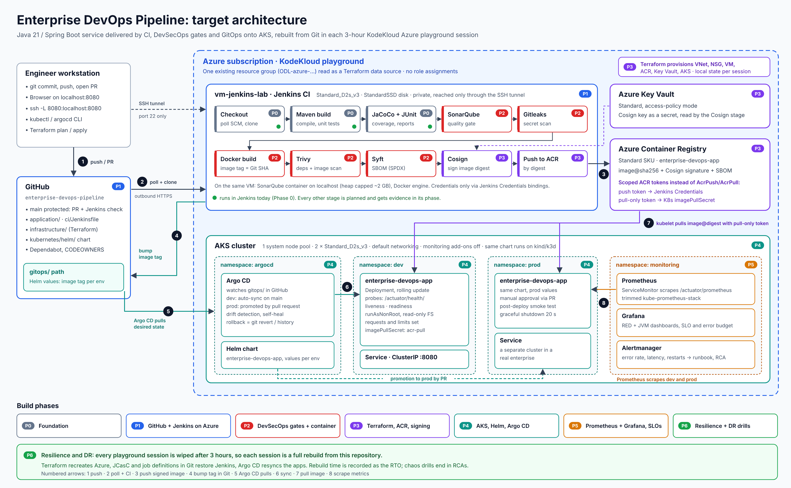
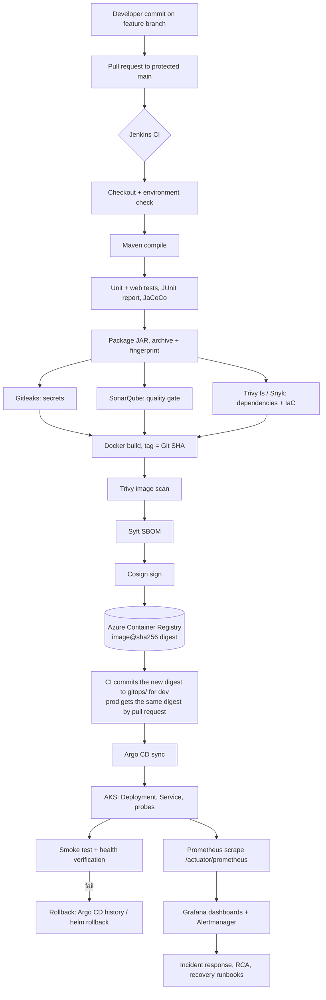
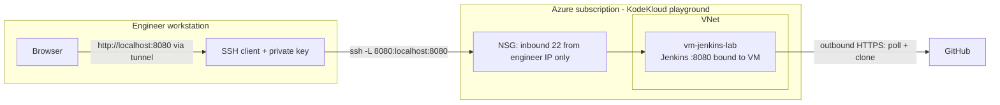

# Architecture Overview

## Objective

Deliver a small Java service from a developer's commit to a monitored Kubernetes workload on Azure, with quality and security checks built into every stage instead of bolted on at the end. The design favours patterns used in regulated enterprises (immutable artifacts, signed images, GitOps, least privilege) while staying runnable inside time-limited KodeKloud Azure playgrounds.

## Diagram



The diagram is generated from [`diagrams/generate_architecture.py`](diagrams/generate_architecture.py). To change it, edit the script and regenerate the SVG, then export a PNG from the SVG with any converter (for example `rsvg-convert -z 2`):

```bash
python3 docs/architecture/diagrams/generate_architecture.py docs/architecture/diagrams/enterprise-devops-pipeline-architecture.svg
```

## Architecture principles

| # | Principle | What it means here |
|---|---|---|
| 1 | **Build once, promote the digest** | The JAR is built and tested once, packaged once, and referenced by `image@sha256:...`. Dev and prod run the identical image; only Helm values differ. |
| 2 | **Pull-based delivery** | CI writes the new digest to Git; Argo CD pulls Git and syncs the cluster. Jenkins holds no kubeconfig: this is the trust boundary between the CI plane and the CD plane. |
| 3 | **Verifiable supply chain** | Commit SHA → image digest → SBOM and Cosign signature, all traceable from a running pod back to the commit. |
| 4 | **Everything as code** | Infrastructure, CI, Jenkins configuration and deployment state live in Git, so any playground session rebuilds the platform from zero. |
| 5 | **SLO-driven operations** | Alerts page on error-budget burn; every alert links a runbook; incidents end in an RCA that feeds the backlog. |

## Playground constraints and design adaptations

| Playground constraint | Design adaptation | Production equivalent |
|---|---|---|
| No Azure role assignments | Repository-scoped ACR tokens and an `imagePullSecret` ([ADR-0007](../decisions/0007-registry-auth-without-role-assignments.md)) | Managed identity with `AcrPull` / `AcrPush` |
| One fixed resource group | Terraform reads it as a data source | Resource groups per environment |
| 3-hour session, then wiped | Scripted rebuild from Git, which doubles as the DR drill | Long-lived environments with backups |
| No inbound path to Jenkins | SCM polling and an SSH tunnel; no public admin UI | GitHub webhooks to private agents, private endpoints |
| 2 small AKS nodes, no Container Insights | Trimmed Prometheus stack; kind/k3d as a fallback | Container Insights or a full Prometheus stack |

## Later options (not on the committed roadmap)

- **Admission policy:** Kyverno verifies Cosign signatures and blocks unsigned or `:latest` images.
- **DORA metrics:** lead time, deployment frequency, change failure rate and MTTR, fed back into the backlog with SLO burn and RCAs.

## Delivery flow (target)



## What exists today versus the target

| Layer | Today (Phase 0) | Target |
|---|---|---|
| Source control | Local Git repository, `main` branch | GitHub, protected `main`, required PR checks, CODEOWNERS |
| CI | `ci/Jenkinsfile` stages 1-6, verified in Jenkinsfile Runner | Same Jenkinsfile on `vm-jenkins-lab`, triggered by SCM polling |
| Quality and security | Gitleaks, Trivy fs, Trivy image and a container smoke test run in Jenkins on every build; SonarQube not yet | All gates enforced in CI, failing the build on policy violations |
| Artifact | Spring Boot fat JAR archived by Jenkins | Same JAR packaged into an image; image promoted by digest |
| Container | Layered non-root image built locally | Pushed to ACR, scanned, SBOM attached, signed |
| Infrastructure | Manually created VM (KodeKloud) | Terraform for network, VM, ACR, AKS, identities |
| Deployment | None | Helm chart, Argo CD Application per environment |
| Observability | `/actuator/health`, liveness/readiness groups, Prometheus endpoint with `application` and `environment` tags | Prometheus, Grafana dashboards, alert rules, runbooks |

## Components

| Component | Role | Why this choice | Phase |
|---|---|---|---|
| GitHub | Source of truth for code and, later, desired cluster state | Required for the portfolio; PR reviews and branch protection | 1 |
| Jenkins | CI orchestration | Still the most common CI in enterprises; Jenkinsfile keeps the pipeline versioned ([ADR-0004](../decisions/0004-jenkins-with-scm-polling.md)) | 0-1 |
| Maven + wrapper | Build and dependency management | Wrapper pins Maven 3.9.11 so every agent builds the same way | 0 |
| Spring Boot 4.1 / Java 21 | Application runtime | Currently maintained LTS-based stack ([ADR-0002](../decisions/0002-java-21-spring-boot-4.md)) | 0 |
| Docker | Packaging | Image built from the already-tested JAR ([ADR-0005](../decisions/0005-container-image-from-ci-jar.md)) | 0-2 |
| SonarQube | Static analysis, coverage and quality gate | Industry standard; integrates with Jenkins via `withSonarQubeEnv` and `waitForQualityGate` | 2 |
| Gitleaks | Secret detection in tree and history | Fast, single binary, good default rules | 2 |
| Trivy | Dependency, image and IaC misconfiguration scanning | One tool for three scan types, offline DB cache possible | 2 |
| Snyk (optional) | Second opinion on dependencies | Needs an account and token, so it stays optional | 2 |
| Syft + Cosign | SBOM and image signature | Supply-chain evidence that can be verified at deploy time | 2-3 |
| Azure Container Registry | Private image registry | Native Azure registry; in the playground accessed with scoped ACR tokens because role assignments are blocked ([ADR-0007](../decisions/0007-registry-auth-without-role-assignments.md)) | 3 |
| Terraform | Infrastructure as code | Plan/apply review workflow, wide Azure support ([ADR-0006](../decisions/0006-terraform-for-azure.md)) | 3 |
| AKS + Helm | Runtime and packaging | Managed Kubernetes; Helm values per environment | 4 |
| Argo CD | GitOps controller | Pull-based deploys, drift detection, one-click rollback ([ADR-0003](../decisions/0003-argo-cd-gitops.md)) | 4 |
| Prometheus + Grafana | Metrics, dashboards, alerting | De facto Kubernetes monitoring stack; app already exposes the metrics | 5 |

## Environments

| Environment | Where | Promotion |
|---|---|---|
| local | Developer machine | n/a |
| ci | Jenkins workspace on `vm-jenkins-lab` | every commit |
| dev | AKS namespace `dev` (planned) | automatic after CI on `main` |
| prod | AKS namespace `prod` (planned; a separate cluster in a real enterprise) | pull request to the GitOps path, manual approval |

## Trust boundaries and access



- Jenkins is never published on a public port. The browser reaches it only through the SSH tunnel.
- Because GitHub cannot reach Jenkins, the pipeline polls GitHub (`pollSCM('H/5 * * * *')`). Webhooks become possible later with a reverse proxy, a relay (for example smee.io for labs), or a private agent pool.
- Credentials enter the pipeline only through Jenkins Credentials bindings. See [security-model.md](../security/security-model.md).

## Application design

- `GET /api/hello?name=<name>` returns `{"message": "<greeting>, <name>!", "environment": "<env>"}`. Input is trimmed, stripped of control characters (prevents log forging) and capped at 64 characters.
- Configuration comes from environment variables through Spring relaxed binding: `SERVER_PORT`, `APP_GREETING`, `APP_ENVIRONMENT`.
- Actuator exposes only `health`, `info` and `prometheus`. Health has `liveness` and `readiness` groups for Kubernetes probes. `env`, `beans`, `heapdump` and the rest stay hidden, and an integration test enforces that.
- Graceful shutdown with a 20 s timeout so rolling updates drain in-flight requests.
- Every metric carries `application` and `environment` tags for Grafana filtering.
- No database in Phase 0. One will be introduced only when a milestone needs stateful behaviour (for example to demonstrate backup and disaster recovery).

## KodeKloud constraints that shape the design

These come from the manual work already done and from KodeKloud's published limits; see [known-issues #6](../troubleshooting/known-issues.md#6-kodekloud-sandbox-limitations) for which points are confirmed.

- One pre-created resource group; new ones are refused. Terraform reads it as a data source.
- Premium disks are blocked; Standard SSD or HDD only. VMs up to `Standard_D2s_v3`.
- Sessions last 3 hours and are wiped, so all state must be reproducible from this repository and each setup must be scripted.
- No role assignments: AKS pulls from ACR with a pull-only ACR token as an `imagePullSecret`, and Jenkins pushes with a push-scoped token ([ADR-0007](../decisions/0007-registry-auth-without-role-assignments.md)), instead of managed identities with `AcrPull`/`AcrPush`.
- AKS is limited to one pool of 2 small nodes without monitoring add-ons; the Helm chart and Argo CD apps must also run on kind or k3d.
